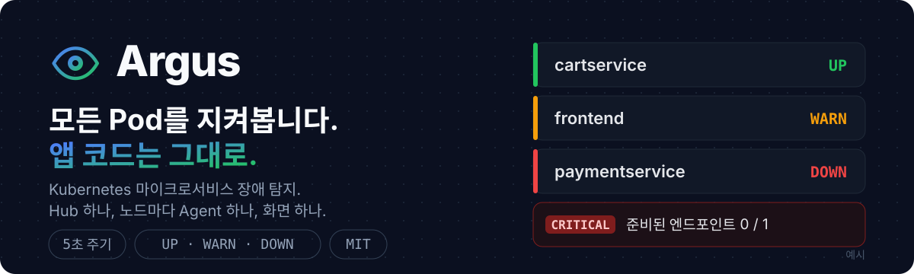
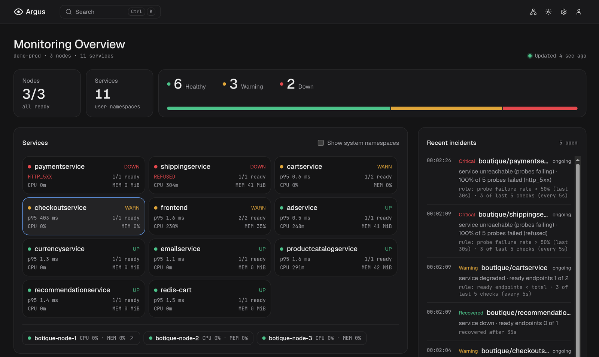
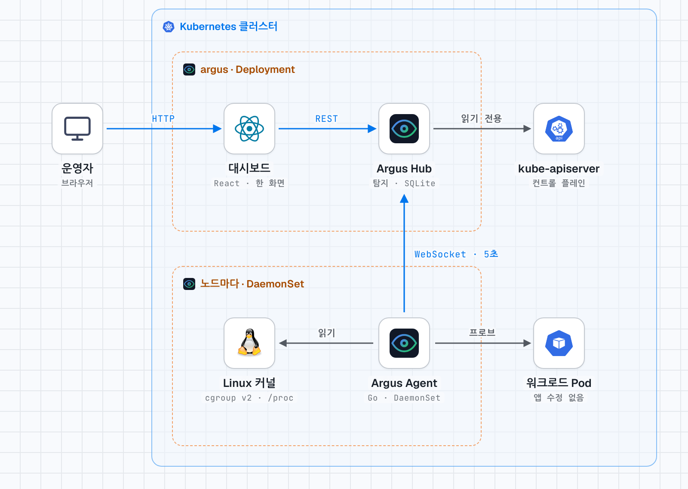

<p align="center">
  
</p>

<p align="center">
  <a href="./README.md">English</a> · <b>한국어</b>
</p>

Argus는 Kubernetes에서 도는 마이크로서비스를 지켜보다가 **어느 서비스가, 어디서, 언제부터** 문제인지 알려 줍니다. **애플리케이션 코드는 바꾸지 않습니다.** 각 노드의 커널과 Kubernetes API만 읽어서 모든 Service를 `UP`, `WARN`, `DOWN`으로 판정합니다.

<p align="center">
  
</p>
<p align="center"><sub>장애를 주입한 모의 클러스터(서비스 11개, 노드 3개)에 연결한 다크 테마 대시보드입니다.</sub></p>

## 무엇을 해 주나요

- **한 화면.** 노드, Service, Pod, 15분 CPU·메모리·p95 응답시간 차트, 최근 장애를 한 곳에서 봅니다. 데이터를 마지막으로 받은 시각이 항상 표시됩니다.
- **사이드카 없는 Pod 지표.** 각 노드의 Agent가 cgroup v2와 `/proc`을 직접 읽습니다. 지표 엔드포인트가 없는 Pod도 Pod별 CPU·메모리·네트워크가 보입니다.
- **판정마다 근거.** 장애에는 규칙, 임계값, 관측값, 판정 구간, 시작·복구 시각이 함께 기록됩니다.
- **Pod 사이 차단 탐지.** 선택 기능으로 호출하는 Pod의 네트워크 네임스페이스 *안에서* 접속을 시도합니다. NetworkPolicy가 `frontend → cart`만 막아도, 노드에서는 `cart`가 정상으로 보이는데도 잡아냅니다.
- **빠르되 조용하게.** 5초마다 수집합니다. 최근 5번 중 3번 위반하면 장애를 열고, 3번 정상이면 닫습니다. 패킷 하나가 유실됐다고 알람이 울리지 않습니다.

## 동작 방식

<p align="center">
  <picture>
    <source media="(prefers-color-scheme: dark)" srcset="./assets/readme/architecture-dark.ko.png">
    
  </picture>
</p>

| 구성 | 실행 형태 | 역할 |
|---|---|---|
| **Agent** | DaemonSet, 노드마다 1개 | 호스트의 cgroup v2와 `/proc`에서 노드·Pod별 CPU, 메모리, 네트워크를 읽습니다. Service를 프로브(TCP/HTTP)하고, 켜면 Pod 안에서도 프로브합니다. Hub로 *먼저 접속*합니다. |
| **Hub** | Deployment, 1 replica | 5초마다 모든 Agent의 데이터를 받고, Kubernetes API에서 Pod·Service·Endpoints·Node를 읽기 전용으로 조회합니다. 탐지 규칙을 돌려 장애를 SQLite에 저장하고 대시보드를 제공합니다. |

Kubernetes API는 Hub만 `get`/`list`로 읽습니다. Agent에는 Kubernetes 권한이 없습니다.

### 탐지 규칙

| 규칙 | 열리는 조건 | 심각도 |
|---|---|---|
| `service_down` | Service 뒤에 준비된 엔드포인트가 없음 | CRITICAL |
| `service_degraded` | 일부 엔드포인트만 준비됨 | WARNING |
| `service_unreachable` | 프로브 실패율 50% 초과(최근 30초) | CRITICAL |
| `service_errors` | 프로브 실패율 10% 초과 | WARNING |
| `service_latency_high` | p95 응답시간 250ms 초과 | WARNING |
| `pod_link_failed` | 설정한 Pod → Service 접속이 Pod 안에서 실패 | WARNING |
| `pod_cpu_high` / `pod_memory_high` | Pod가 CPU / 메모리 제한의 85% / 90% 초과 | WARNING |
| `pod_unhealthy` | `CrashLoopBackOff`, `OOMKilled`, 이미지 풀 실패 | WARNING |
| `node_down` | Agent가 3번 연속 무응답이거나 kubelet이 NotReady 보고 | CRITICAL |
| `node_cpu_high` / `node_memory_high` / `node_pressure` | 노드 90% 초과 또는 압력 상태 | WARNING |

Service 상태는 장애를 따라갑니다. 열린 장애가 없으면 `UP`, 경고면 `WARN`, 심각이면 `DOWN`입니다. 장애가 닫히면 `RECOVERED` 이벤트가 남습니다. 임계값은 코드의 기본값(`internal/hub/detect/types.go`)이며 아직 실행 중에 바꿀 수 없습니다.

## 빠른 시작

cgroup v2 노드로 된 Kubernetes 클러스터, 그 클러스터에 접근할 수 있는 `kubectl`, `helm` 3.8 이상이 필요합니다. 그 외에는 필요 없습니다. 이미지와 차트를 모두 Docker Hub에서 받습니다.

**1. 클러스터에 저장소가 있는지 확인합니다.** Hub는 계정과 장애 이력을 볼륨 위의 SQLite 파일에 저장하므로 기본 StorageClass가 필요합니다. k3s에는 내장되어 있고, 순정 kubeadm 클러스터에는 없습니다.

```bash
kubectl get storageclass          # 한 줄에 "(default)"가 있어야 함
```

`(default)`가 없으면 [local-path-provisioner](https://github.com/rancher/local-path-provisioner)를 설치하고 기본으로 지정합니다.

```bash
kubectl apply -f https://raw.githubusercontent.com/rancher/local-path-provisioner/master/deploy/local-path-storage.yaml
kubectl patch storageclass local-path -p '{"metadata":{"annotations":{"storageclass.kubernetes.io/is-default-class":"true"}}}'
```

local-path는 Hub가 뜬 노드의 디스크에 데이터를 두므로, 그 노드는 끄지 마세요. 저장소 없이 먼저 써 보려면 이 단계를 건너뛰고 아래 설치 명령에 `--set hub.persistence.enabled=false`를 붙이세요. 이 경우 Hub Pod가 재시작될 때 계정과 장애 이력이 사라집니다. 저장소가 없으면 Hub가 "unbound immediate PersistentVolumeClaims"로 `Pending`에 머뭅니다.

**2. 설치합니다.**

```bash
helm install argus oci://registry-1.docker.io/seoulorigin/argus \
  -n argus --create-namespace \
  --set hub.service.type=NodePort --set hub.service.nodePort=30090

# 로그인: 계정 admin@argus.local, 비밀번호는 설치 때 생성됨
kubectl -n argus get secret argus-argus-auth -o jsonpath='{.data.ADMIN_PASSWORD}' | base64 -d; echo
```

`http://<아무-노드-IP>:30090`으로 접속합니다. NodePort를 쓰지 않으면 `kubectl -n argus port-forward svc/argus-argus-hub 8090:8090` 후 `http://127.0.0.1:8090`으로 접속합니다. VPN과 kubeconfig로 클러스터에 닿는 노트북에서 그대로 쓸 수 있고, 클러스터 노드에 아무것도 따로 설치하지 않습니다.

Agent는 스스로 등록합니다. 차트가 공용 토큰을 만들고, Agent가 Hub의 공개키를 받아 오며, 노드는 약 15초 안에 대시보드에 나타납니다. 이미지는 `linux/amd64`와 `linux/arm64`로 게시되어 있어서 아키텍처가 섞인 클러스터에서도 동작합니다.

### 업그레이드

`--version`을 생략하면 Helm이 가장 최신 릴리스를 설치합니다. 특정 버전에 머물려면 `--version <x.y.z>`를 붙이세요. 이미 설치한 것을 최신 릴리스로 올리려면 다음을 실행합니다.

```bash
helm upgrade argus oci://registry-1.docker.io/seoulorigin/argus -n argus --reset-then-reuse-values
```

`helm upgrade`는 자동으로 실행되지 않습니다. 설치된 버전은 이 명령을 실행하기 전까지 그대로입니다. `--reset-then-reuse-values`는 설치할 때 지정한 값은 유지하면서 새 릴리스에 추가된 기본값은 반영합니다. 차트와 이미지는 같은 버전 번호를 쓰므로, 차트를 올리면 이미지도 함께 올라갑니다.

### Service별 프로브 방식 바꾸기

기본은 첫 번째 TCP 포트로의 TCP 접속입니다. Service마다 annotation으로 바꿉니다.

```bash
kubectl annotate svc my-api argus/probe=http:/healthz     # HTTP GET, 5xx가 아니면 정상
kubectl annotate svc my-api argus/probe-port=8080         # 포트 지정
kubectl annotate svc legacy  argus/probe=off              # 프로브 안 함
```

### Pod → Service 점검 (선택)

두 Service가 노드에서는 정상으로 보이는데, 두 Pod 사이만 NetworkPolicy나 잘못된 경로로 끊긴 경우를 탐지합니다.

```bash
helm upgrade argus deploy/helm/argus -n argus --reuse-values \
  --set podProbe.enabled=true \
  --set 'podProbe.pairs={shop/frontend>shop/cart,shop/checkout>shop/payment:50051}'
```

짝은 `네임스페이스/호출하는쪽>네임스페이스/받는쪽[:포트]` 형식입니다. 실행 중인 호출 Pod마다, 그 Pod가 있는 노드의 Agent가 Pod의 네트워크 네임스페이스로 들어가 받는 쪽 ClusterIP로 접속합니다. 목록이 비면 아무것도 재지 않습니다.

> **보안 비용.** 다른 Pod의 네임스페이스에 들어가려면 Agent에 `SYS_PTRACE`, `SYS_ADMIN`, AppArmor `Unconfined`가 필요합니다. 노드의 root에 가까운 권한이라 **기본은 꺼져 있습니다.** Pod CPU·메모리·트래픽 수집은 추가 권한 없이 동작합니다.

## 설정

| 값 | 기본값 | 의미 |
|---|---|---|
| `clusterName` | 릴리스 이름 | 대시보드 상단에 표시되는 이름 |
| `auth.adminEmail` / `adminPassword` / `agentToken` | 자동 생성 | 로그인과 Agent 등록. 한 번 만들고 업그레이드해도 유지됩니다. `auth.existingSecret`으로 직접 만든 Secret 사용 가능 |
| `hub.service.type` / `nodePort` | `ClusterIP` | 대시보드 노출 방식 |
| `hub.persistence.size` | `2Gi` | SQLite 볼륨(장애, 계정) |
| `agent.stateHostPath` | `/var/lib/argus-agent` | 재시작해도 Agent 신원을 유지 |
| `podProbe.enabled` / `pairs` | `false` / `[]` | Pod → Service 점검 |
| `hub.persistence.enabled` | `true` | `false`면 데이터를 Pod 안에만 둠(재시작하면 사라짐) |
| `image.*.repository` / `tag` | `seoulorigin/argus-hub`, `…/argus-agent`; 태그 = 차트 `appVersion` | 이미지 위치 |

나머지는 [`deploy/helm/argus/values.yaml`](./deploy/helm/argus/values.yaml)을 보세요.

## 개발

```bash
make test        # go vet + go test (tags: testing no_ui)
make build       # UI + bin/argus-hub, bin/argus-agent (CGO 끔, 정적 빌드)
make helm-lint
```

### 릴리스 게시

이미지는 `docker buildx`로 빌드하므로 CPU나 OS와 상관없이 Docker가 있는 어떤 머신에서도 빌드할 수 있고, 명령 하나로 전부 게시됩니다. Docker Hub 계정과 `helm` 3.8 이상이 필요합니다.

```bash
docker login
helm registry login registry-1.docker.io -u <Docker-Hub-사용자>

make release VERSION=0.1.1                      # amd64 + arm64 이미지, 그다음 차트
make release VERSION=0.1.1 REGISTRY=<내-계정>    # 내 계정으로 게시하려면
```

차트 버전과 이미지 태그가 같은 숫자라서, 차트 `0.1.1`을 설치하면 항상 이미지 `0.1.1`을 받습니다. 릴리스마다 새 버전을 쓰세요. 같은 태그를 다시 쓰면 노드가 옛 이미지를 그대로 씁니다. `make images`는 이 머신용 이미지만 만들어 로컬 Docker에 올리므로, 변경을 시험해 보기에 충분합니다.

Hub와 UI에는 Go 1.27과 Node 22를 씁니다. Hub는 [PocketBase](https://pocketbase.io) 기반 Go 서비스에 React UI를 얹었고, Agent는 정적 Go 바이너리 하나입니다.

```
agent/                 Agent: 노드·Pod cgroup 수집, 프로브, netns 접속
internal/hub/k8s/      Kubernetes 읽기 전용 뷰 (Pod, Service, Endpoints, Node)
internal/hub/detect/   탐지 규칙과 장애 생명주기
internal/hub/systems/  Agent 폴링과 노드별 상태
internal/site/         React 대시보드
deploy/                Dockerfile과 Helm 차트
```

## 한계

- **Hub는 1개.** 저장소가 SQLite입니다. 15분 차트 이력은 Hub 메모리에 있어서 재시작하면 비어 있다가 다시 쌓입니다.
- **cgroup v2 Linux 노드.** k3s에서 확인했고, kubeadm 클러스터의 systemd 드라이버 경로 형식도 수집기가 해석합니다.
- **TCP와 HTTP만.** UDP만 쓰는 Service는 프로브하지 않습니다. Pod → Service 점검은 목록에 적은 짝만 봅니다.
- **검증 범위.** 탐지 규칙과 Pod·프로브 로직은 단위 테스트(`make test`)로 확인합니다. 노드 종료나 카오스 주입 같은 다중 노드 장애 실험은 CI가 아니라 수동으로 합니다.
- **알림 전송 없음.** 장애는 대시보드와 Hub 로그에 나타납니다. 이메일·웹훅 전송은 아직 없습니다.

## 라이선스

[MIT](./LICENSE) © 2026 seoulorigin
