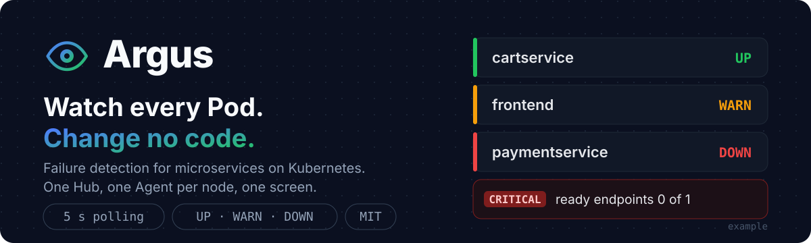
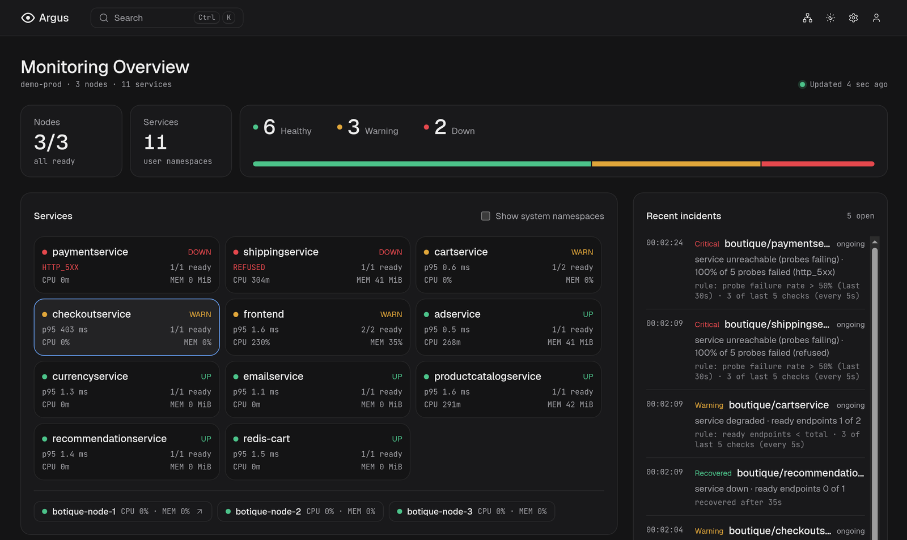
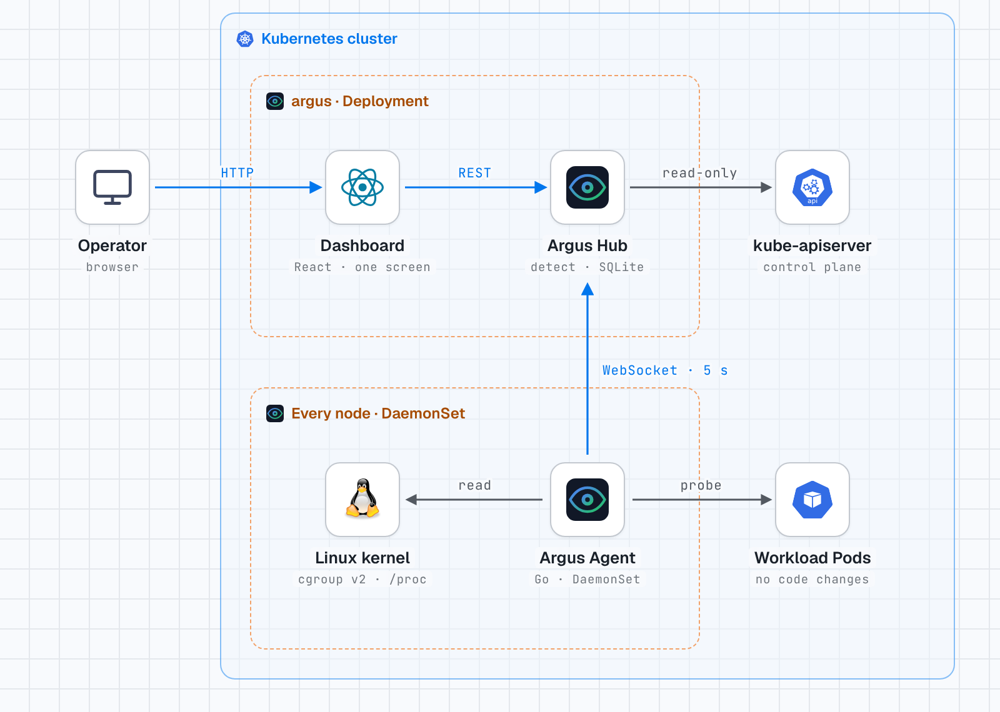

<p align="center">
  
</p>

<p align="center">
  <b>English</b> · <a href="./README.ko.md">한국어</a>
</p>

Argus watches microservices running on Kubernetes and tells you which one is failing, where, and since when. It needs **no change to the applications**: it reads the kernel on each node and the Kubernetes API, then judges every Service as `UP`, `WARN` or `DOWN`.

<p align="center">
  
</p>
<p align="center"><sub>The dashboard in dark theme, against a simulated cluster (11 services, 3 nodes) with injected failures.</sub></p>

## What you get

- **One screen.** Nodes, Services, Pods, 15-minute CPU / memory / p95 response charts, and the latest incidents. The page always shows when the data was last updated.
- **Pod-level metrics without sidecars.** Each node's Agent reads cgroup v2 and `/proc` directly, so CPU, memory and network are per Pod, even for Pods that have no metrics endpoint.
- **A reason with every verdict.** An incident records the rule, the threshold, the observed value, the window it was decided in, and when it started and recovered.
- **Blocked connections between Pods.** Optional checks open the connection from *inside* the caller's network namespace, so a NetworkPolicy that cuts `frontend → cart` shows up even though `cart` looks healthy from every node.
- **Fast and calm.** Data every 5 seconds. A condition must hold in 3 of the last 5 checks to open an incident, and 3 clean checks to close it, so one lost packet does not page anyone.

## How it works

<p align="center">
  <picture>
    <source media="(prefers-color-scheme: dark)" srcset="./assets/readme/architecture-dark.png">
    
  </picture>
</p>

| Part | Runs as | Does |
|---|---|---|
| **Agent** | DaemonSet, one per node | Reads node and per-Pod CPU, memory and network from the host's cgroup v2 and `/proc`. Probes Services (TCP or HTTP) and, when enabled, probes from inside Pods. Connects *out* to the Hub. |
| **Hub** | Deployment, 1 replica | Polls every Agent each 5 s, reads Pods / Services / Endpoints / Nodes from the Kubernetes API (read-only), runs the detection rules, stores incidents in SQLite, serves the dashboard. |

Only the Hub talks to the Kubernetes API, and only with `get` / `list`. Agents have no Kubernetes permissions.

### What gets detected

| Rule | Opens when | Severity |
|---|---|---|
| `service_down` | no ready endpoint behind the Service | CRITICAL |
| `service_degraded` | some, but not all, endpoints ready | WARNING |
| `service_unreachable` | more than 50 % of probes fail (last 30 s) | CRITICAL |
| `service_errors` | more than 10 % of probes fail | WARNING |
| `service_latency_high` | p95 response above 250 ms | WARNING |
| `pod_link_failed` | a configured Pod → Service connection fails from inside the Pod | WARNING |
| `pod_cpu_high` / `pod_memory_high` | Pod above 85 % / 90 % of its CPU / memory limit | WARNING |
| `pod_unhealthy` | `CrashLoopBackOff`, `OOMKilled`, image pull failure | WARNING |
| `node_down` | Agent silent for 3 checks, or kubelet reports NotReady | CRITICAL |
| `node_cpu_high` / `node_memory_high` / `node_pressure` | node above 90 %, or a pressure condition | WARNING |

A Service's status follows its incidents: no open incident is `UP`, a warning is `WARN`, a critical one is `DOWN`. When an incident closes, a `RECOVERED` event is recorded. The thresholds are built-in defaults (`internal/hub/detect/types.go`); they are not yet configurable at runtime.

## Quick start

You need a Kubernetes cluster with cgroup v2 nodes, `kubectl` access to it, and `helm` 3.8+. Nothing else: the images come from Docker Hub and the chart from the same place.

```bash
helm install argus oci://registry-1.docker.io/seoulorigin/argus \
  -n argus --create-namespace \
  --set hub.service.type=NodePort --set hub.service.nodePort=30090

# Log in: user admin@argus.local, password generated on install
kubectl -n argus get secret argus-argus-auth -o jsonpath='{.data.ADMIN_PASSWORD}' | base64 -d; echo
```

Open `http://<any-node-ip>:30090`. Without a NodePort, use `kubectl -n argus port-forward svc/argus-argus-hub 8090:8090` and open `http://127.0.0.1:8090`. Both work from a laptop that reaches the cluster through a VPN and a kubeconfig; nothing needs to be installed on the cluster nodes.

Agents register themselves: the chart creates one shared token, the Agent fetches the Hub's public key, and each node appears in the dashboard within about 15 seconds. Images are published for `linux/amd64` and `linux/arm64`, so mixed clusters work.

### Upgrading

Without `--version`, Helm installs the newest release. To stay on a specific one, add `--version <x.y.z>`. To move an existing install to the newest release:

```bash
helm upgrade argus oci://registry-1.docker.io/seoulorigin/argus -n argus --reset-then-reuse-values
```

`helm upgrade` is never automatic: a running install keeps its version until you run it. `--reset-then-reuse-values` keeps the values you set at install time and still picks up defaults added by the new release. Chart and images share one version number, so upgrading the chart upgrades the images with it.

> **Hub stays `Pending` with "unbound immediate PersistentVolumeClaims"?** The Hub keeps accounts and incident history in a SQLite file on a volume, and the cluster has no default StorageClass (k3s has one built in; a plain kubeadm cluster does not). Either install a provisioner such as [local-path-provisioner](https://github.com/rancher/local-path-provisioner), or try Argus without storage by adding `--set hub.persistence.enabled=false`. Without storage, accounts and incident history are lost whenever the Hub Pod restarts.

### Probing a Service differently

By default every Service is probed with a TCP connect to its first TCP port. Change that per Service with annotations:

```bash
kubectl annotate svc my-api argus/probe=http:/healthz     # HTTP GET, expects non-5xx
kubectl annotate svc my-api argus/probe-port=8080         # pick the port
kubectl annotate svc legacy  argus/probe=off              # do not probe
```

### Pod-to-Service checks (optional)

Detect a connection that a NetworkPolicy or a bad route cuts between two Pods while both Services look healthy from the nodes:

```bash
helm upgrade argus deploy/helm/argus -n argus --reuse-values \
  --set podProbe.enabled=true \
  --set 'podProbe.pairs={shop/frontend>shop/cart,shop/checkout>shop/payment:50051}'
```

Each pair is `namespace/caller>namespace/callee[:port]`. For every running caller Pod, its node's Agent enters the Pod's network namespace and connects to the callee's ClusterIP. An empty list measures nothing.

> **Security cost.** Entering another Pod's namespace needs `SYS_PTRACE` and `SYS_ADMIN` plus an `Unconfined` AppArmor profile on the Agent. That is close to root on the node, so it is **off by default**. Pod CPU, memory and traffic collection works with no extra capabilities.

## Configuration

| Value | Default | Meaning |
|---|---|---|
| `clusterName` | release name | Name shown in the dashboard header |
| `auth.adminEmail` / `adminPassword` / `agentToken` | generated | Login and Agent registration. Generated once, kept on upgrade. `auth.existingSecret` uses your own Secret |
| `hub.service.type` / `nodePort` | `ClusterIP` | How the dashboard is exposed |
| `hub.persistence.size` | `2Gi` | SQLite volume (incidents, accounts) |
| `agent.stateHostPath` | `/var/lib/argus-agent` | Keeps each Agent's identity across restarts |
| `podProbe.enabled` / `pairs` | `false` / `[]` | Pod-to-Service checks, see above |
| `hub.persistence.enabled` | `true` | `false` keeps the data in the Pod (lost on restart) |
| `image.*.repository` / `tag` | `seoulorigin/argus-hub`, `…/argus-agent`; tag = chart `appVersion` | Image locations |

See [`deploy/helm/argus/values.yaml`](./deploy/helm/argus/values.yaml) for everything else.

## Develop

```bash
make test        # go vet + go test (tags: testing no_ui)
make build       # UI + bin/argus-hub, bin/argus-agent (CGO off, static)
make helm-lint
```

### Publishing a release

Images are built with `docker buildx`, so any machine with Docker can build them regardless of its own CPU or OS, and one command publishes everything. You need a Docker Hub account and `helm` 3.8+.

```bash
docker login
helm registry login registry-1.docker.io -u <your-docker-hub-user>

make release VERSION=0.1.1                      # images for amd64 + arm64, then the chart
make release VERSION=0.1.1 REGISTRY=<your-user>  # publish under your own account instead
```

The chart version and the image tag are the same number, so a user who installs chart `0.1.1` always gets images `0.1.1`. Use a new version for every release; reusing a tag keeps nodes on the old image. `make images` builds for this machine only and loads the result into the local Docker, which is enough to try a change.

Go 1.27 and Node 22 are used for the Hub and the UI. The Hub is a [PocketBase](https://pocketbase.io)-based Go service with a React UI; the Agent is a single static Go binary.

```
agent/                 Agent: node + Pod cgroup collection, probes, netns dial
internal/hub/k8s/      read-only Kubernetes view (Pods, Services, Endpoints, Nodes)
internal/hub/detect/   detection rules and incident lifecycle
internal/hub/systems/  Agent polling and per-node state
internal/site/         React dashboard
deploy/                Dockerfiles and the Helm chart
```

## Limits

- **Single Hub replica.** SQLite is the datastore. The 15-minute chart history lives in Hub memory and starts empty after a restart.
- **cgroup v2 on Linux nodes.** Verified on k3s; the collector also parses the systemd-driver path layout used by kubeadm clusters.
- **TCP and HTTP only.** UDP-only Services are not probed. Pod-to-Service checks cover only the pairs you list.
- **Tested scope.** Unit tests cover the detection rules and the Pod and probe logic (`make test`). Full multi-node failure runs (node shutdown, chaos injection) are done by hand, not by CI.
- **No notifications yet.** Incidents show in the dashboard and the Hub log; there is no email or webhook sender.

## License

[MIT](./LICENSE) © 2026 seoulorigin
